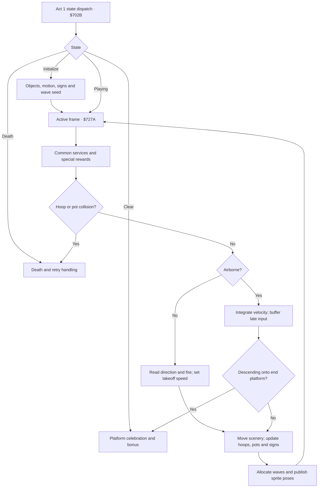

> Historical report. Current gameplay requirements and remaining work are in
> [ARCADE-FIDELITY.md](ARCADE-FIDELITY.md); current results are in
> [validation.md](validation.md).

# Act 1: measured arcade timing and the Atari revision

This revision brings Act 1 closer to the movement, jump timing and obstacle spacing recovered from the original Circus Charlie executable. The reported sluggishness was subsequently traced to the host computer's energy-saving mode slowing its emulator. That report is not evidence of a port timing defect; the changes here are based on measurements of the original game. It also adds the blue support pipe, white hangers, dark green field bands, distance signs and a raised landing platform. Money-bag hoops are shorter and higher. The other acts retain their existing gameplay and Bold Arcade artwork. Revision 7 corrected hoop depth and restored the scrolling purple-and-white bunting. Revision 8 also corrects the visible aperture: the upper cap is high enough for the complete jumping silhouette, including Charlie’s head.

## What was examined

The input was the user's `circusc.zip`, SHA-256 `a3356f8a621b7b234b8a8342bcfce03a89e64775259621f25c05ddd0f67280c0`. MAME's KONAMI-1 debugger disassembled the encrypted 6809 instruction stream; The $6000–$FFFF disassembly was used for analysis and is not included in the source package. Data tables were read from the original data view, separately from decrypted instructions. This is disassembly and executable observation, not a reconstruction from a manual. A linear disassembly also decodes data as instructions; only the traced/control-flow-supported regions below are interpreted as code.

MAME 0.251 ran controlled neutral, running, single-jump and held-fire experiments. A reactive joystick/fire player cleared the arcade act after one death. A separate **instrumented sweep** froze clearance RAM so hazards could be measured without interruption. That sweep is not claimed as an ordinary-input playthrough. Per-frame object and release CSVs, a measured jump CSV, the Lua player, and a reproducible extraction script are included.

The original hardware raster clock is 6.144 MHz / (384 × 264) = **60.606 Hz**, from the included MAME driver. This older MAME executable reports **60.000 Hz**. Frame counts are used for comparison; hardware seconds and that emulator's stopwatch are not conflated. The jump trace is joined to its event log: its takeoff is frame 821 and landing frame 884. One earlier debugger callback omitted frame 700, so raw file offsets must not be treated as frame numbers.

## Measured behavior

| Behavior | Arcade evidence | Atari implementation |
| --- | --- | --- |
| Run right | Movement table $F153: 1.5 arcade pixels per frame | 1.125 Atari colour pixels per simulation tick; 3/4 horizontal scale |
| Walk left | $F153: 1.1875 pixels per frame | 0.890625 colour pixels per tick |
| Hoop movement | $77A5 subtracts $0080: hoops approach even while Charlie stands still | 0.375 colour pixels per tick independent drift |
| Running approach | 1.5 + 0.5 = 2 arcade pixels per frame | 1.5 colour pixels per tick |
| Jump | $750F starts at −$0380; $7394 adds $001C each frame | Exact 64-sample observed height sequence, including takeoff and landing |
| Jump duration and apex | 63 frame intervals airborne; 54.25 fixed-point pixels, 55 displayed pixels at the apex | Same frame counts and displayed vertical heights; about 1.04 seconds |
| Airborne control | Movement established at takeoff; late landing input buffered at $73CF–$73F2 | Arcade takeoff momentum and a short landing input buffer; this deliberately replaces Act 1's earlier midair steering |
| Double hoops | $F80B gap table includes 27; constant-right sweep releases at frames 1568 and 1582 | Original table data and 14-tick close-pair interval at the first rank |
| Money hoop | Dedicated fourth slot at $2760; collision test adds 16 at $72E9 | 16 scanlines shorter with the lower edge raised; walking underneath is safe |
| Collecting a bag | Ordinary hoop and money hoop have different clearance tests | A middle-height jump can hit it; high clearance collects once |
| Pots | $7366–$7380; first course has five measured pot centres | Normal-course positions scaled from the sweep; eight derived positions on repeat ranks |
| Signs | $7225 / $763F and table $EF5E | 60M, 50M, 40M, 30M, 20M, 10M and GOAL in the scene |
| Finish | $73A0–$73B1 tests late-course jump height and transfers to $7B78 | Descending landing on the raised platform; crossing the finish on foot does not clear |

The selected normal-course Atari input route now clears in **1,228 simulation ticks**, approximately **20.3 seconds** of active play. The previous checkpoint route took 2,254 ticks, approximately 37.6 seconds. These are replay completion times, not speedrun records or a controlled comparison of two identical courses. Faster progress comes from the restored spatial scale, course extent and hoop schedule. The original jump actually lasts longer than the old port's roughly 54-tick arc; merely increasing gravity would not have reproduced it.

## Recovered control flow

This chart summarizes the original active-play relationships. Rendering, audio and common game services are folded into one step; it is not a claim that the entire ROM is represented here.

The hoop scheduler uses three ordinary slots plus one money slot. Relative approach decrements a gap accumulator, then a table entry schedules the next release. A short entry produces a pair rather than a uniformly spaced sequence. Money selection also depends on a frame-derived seed and the preceding gap. This explains why an arcade session's exact bag timing can differ even with similar movement.

## Features found beyond the visible obstacles

| Feature found in the executable | Evidence / confidence | Status in this revision |
| --- | --- | --- |
| Increasing money-bag awards | $72F5–$7326 increments a capped prize index, corresponding to 1,000 through 5,000 | Existing Atari 200-point total retained; exact arcade scoring is not claimed |
| Landing-based hoop/pot accounting | $7477–$74D0 counts objects crossed during the jump | Existing Atari individual awards retained |
| Special hoop / extra-life state | $733E–$7360 and $781C–$7863 use $220A and a saved hoop pointer | Not implemented; exact player trigger still needs a dedicated original-game replay |
| Additional special reward objects | $7289–$72C5 and $741C onward | Branches identified; complete coin/doll/bird conditions and sequences remain unverified |
| Free-running wave variation | $704A saves the frame seed; $77F8 and $787F use it for money decisions | Deterministic seed for repeatable Atari play and testing |
| Finish approach depends on course state | $77B8 checks late-course progress and a counter | Atari uses a bounded end-of-course spawn cutoff |

The retained continue, two-player careers, menu settings, progress rules and scoring are documented in the main README. This timing revision does **not** establish complete arcade parity. In particular, the reverse-travel allocator, secret rewards, exact repeat-course pot allocator and arcade score ladder remain adaptations or work to verify. They are recorded here so they cannot disappear from the feature budget.

## Graphics and player/missile use

Charlie and the lion use a compact **24 × 32 colour-pixel/scanline** character stamp. The airborne image is extracted from an actual arcade jump, rather than reusing a walking pose. Ordinary hoops occupy 16 × 72; money hoops occupy 16 × 56, including their hanging hardware. The money hoop retains the ordinary width, with a smaller vertical opening and a higher bottom edge, as observed in the arcade. These are Atari-adapted graphics, not pixel-identical arcade hoops. In v8 the ordinary rim spans playfield scanlines 76–139 and the money rim spans 76–123. The hanger is shorter and flames stay outside the rim. At legal central crossing heights, the full native actor silhouette has at least two empty scanlines above and below it, including all four PM flame phases. This fixes the previous cap intersection without shrinking the actor or changing the jump.

All **four hardware players** are available for animated hoop fire. Each uses double-width pixels and one of four flame phases; the shorter hoop has four separate variants. Gold rims, white arms, the blue rail, Charlie/lion, pots, bags, signs and the landing platform are ANTIC 4 character graphics. Missiles remain disabled and available. There is no horizontal player multiplexing in Act 1. PRIOR=4 places the character rim/arm in front of the player flames. Positions, colours and PM memory switch atomically with the display buffer.

The near (left) semicircle is composited over Charlie/lion after the actor stamp, while the far semicircle stays behind it. This makes the rider pass through the opening. The compositor changes only the actor’s private glyphs; it allocates no new glyphs or hardware players. Gold foreground pixels become light highlights in an alternate-colour actor cell, preserving Charlie’s palette.

All six rows of the audience and purple-and-white bunting now move together with the camera, including the entrance across their boundary. The two bunting rows were omitted from the previous four-row scrolling pass. Prepared periodic strips and wrapped detail stores restore their movement without changing the artwork.

DLI changes supply the alternating bright/dark green field bands without repainting them each frame. Glyphs and horizontal shifts are prepared offline. Small native ROM routines draw clipped objects, restore hoop rectangles and copy the bag/flame data. No runtime sprite scaling or host rendering is involved.

## Performance and limits

The final cartridge runs the Act 1 simulation at approximately **60.6 ticks/second** on both standards. It presents complete pictures every two Atari refreshes: about **29.96 FPS NTSC / 24.93 FPS PAL**. It does not reproduce the arcade's one-picture-per-arcade-frame motion smoothness. Input is sampled in VBI and Act 1's next simulation batch is no longer precomputed immediately after rendering, reducing the extra input delay of the earlier renderer.

All four Act 1 ranks finish using ordinary input replays on Atari800, on both standards, with zero missed deadlines, zero rendering faults and no lost lives. All seven scenes also finish in the unchanged cartridge's OPTION demo on PAL and NTSC. CPU-only checks cover all 28 scene/rank combinations. These results cover the tested routes, not every possible play history, and are not a promise that the remaining cycles can all be spent on additional graphics.

The separate validation report lists pixel-reference comparisons, collision/jump checks, audio interrupts and build reproduction. Testing used **Atari800 5.0.0, XL/64 KB, Altirra replacement OS**, not the Altirra emulator application or physical Atari hardware. The delivered video is a native emulator capture at normal speed with its POKEY audio.

## Reproduce or inspect

- `research/arcade-program.asm`: decrypted-instruction listing; data regions still need to be read as data.
- `research/circusc-driver.cpp`: source snapshot documenting the original machine/clock.
- `research/arcade-act1.lua`: emulator inputs, write taps, RAM capture and screenshots.
- `research/run-arcade.sh`: requires MAME and the user's own ROM set through `MAME_ROM_DIR`.
- `research/extract-observations.py`: derives measured CSVs from the captured frame/event files.
- `evidence/arcade-act1-jump.csv`, `arcade-act1-releases.csv`, `arcade-act1-object-frames.csv`: original-game observations.
- `src/lion-arcade.s`, `src/lion-arcade-tables.inc`: native Atari logic and the recovered table values.
- `tests/arcade_lion.py`, `tests/bold_render.py`, `tests/hoop_depth.py`: physics, collision, scheduling and renderer reference checks.
- `tests/hoop_passage.py`: independent opening/actor measurements from assembled ANTIC and PM memory; the v7 negative control fails this check.
- `tests/hud_cache.py`: cached numeric HUD updates match a full redraw.

Technical reference: [MAME debugger memory/disassembly commands](https://docs.mamedev.org/debugger/memory.html) and [official Circus Charlie driver](https://github.com/mamedev/mame/blob/master/src/mame/konami/circusc.cpp). The gameplay measurements above come from the supplied executable and recorded emulator state.
